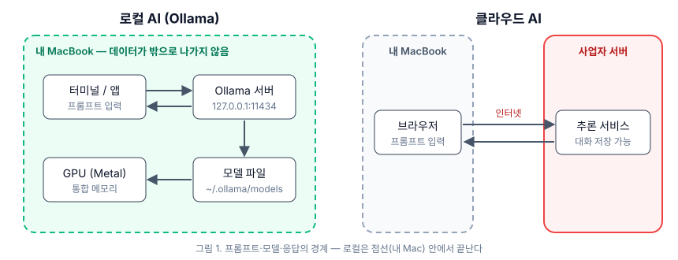
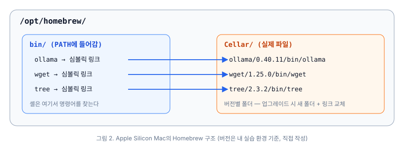
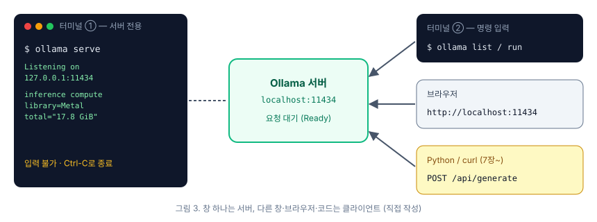

# [로컬 AI 스터디 1주차] Homebrew와 Ollama로 맥북에 로컬 LLM 실행 환경 구성하기

1주차에서는 교재 1부(1~3장)를 다룹니다. 터미널 기초, Homebrew 설치, Ollama 설치와 실행이 범위입니다. 이 글에서는 각 장의 주요 내용을 간략히 정리한 뒤, 실제 맥북에서 실습한 과정과 교재와 다르게 나타난 부분을 함께 기록합니다.

실습 환경은 다음과 같습니다.

| 항목 | 내용 |
| --- | --- |
| 기기 | MacBook Pro, Apple M4 Pro (14코어: 성능 10 + 효율 4) |
| 메모리 | 24GB 통합 메모리 |
| OS | macOS 26.5 |
| Homebrew / Ollama | 6.0.5 / 0.40.11 |

---

## 1장. 로컬 AI 시작하기

### 로컬에서 AI를 실행하는 이유

교재는 로컬 AI를 사용하는 이유로 네 가지를 제시합니다.

1. **개인정보 보호**: 입력한 내용이 외부 서버로 전송되지 않습니다.
2. **음성 프라이버시**: 음성 데이터도 기기 밖으로 나가지 않습니다.
3. **자유**: 서비스 제공자의 약관 변경, 가격 인상, 서비스 종료에 영향을 받지 않습니다.
4. **이해**: 직접 구성하는 과정에서 AI의 동작 원리를 익힐 수 있습니다.



두 방식의 차이는 데이터가 처리되는 경계에 있습니다. 클라우드 AI는 프롬프트가 인터넷을 거쳐 사업자의 서버에서 처리되고, 로컬 AI는 프롬프트, 모델, 응답이 모두 사용자의 기기 안에서 처리됩니다. 반면 로컬 모델은 클라우드 모델보다 규모가 작고, 학습 시점 이후의 정보를 반영하지 못한다는 한계가 있습니다.

| 기준 | 클라우드 AI | 로컬 AI (Ollama) |
| --- | --- | --- |
| 모델 규모 | 수천억 파라미터 | 1B~70B 수준 |
| 최신성 | 지속적으로 업데이트 | 학습 시점에 고정 |
| 데이터 위치 | 사업자 서버로 전송 | 기기 내부에 유지 |
| 인터넷 연결 | 항상 필요 | 모델 다운로드 이후 불필요 |
| 성능 결정 요인 | 서버 부하, 네트워크 | 로컬 하드웨어 |

교재는 두 방식을 상호 배타적으로 보지 않습니다. 고난도 추론에는 클라우드 AI를, 민감한 데이터나 실험에는 로컬 AI를 쓰는 것처럼 용도에 따라 함께 활용할 것을 권합니다. 실무에서도 외부 AI 서비스를 도입할 때는 데이터 반출 여부가 가장 먼저 검토됩니다. 따라서 로컬 LLM은 사내 도구 프로토타입처럼 보안 검토가 까다로운 영역에서 특히 유용한 선택지라고 판단됩니다.

### LLM의 기본 개념

LLM은 다음에 올 토큰을 확률적으로 예측해 문장을 생성합니다. 사실을 저장해 두었다가 꺼내는 방식이 아니므로, 그럴듯하지만 부정확한 답변(환각, hallucination)을 생성할 수 있습니다. 중요한 결과는 반드시 검증해야 합니다. 이 현상은 아래 실습에서 1B 모델을 실행하며 직접 확인할 수 있었습니다.

### 교재의 최종 결과물

교재는 음성으로 대화하는 로컬 AI 채팅 애플리케이션을 최종 결과물로 하며, 구성 요소는 다음과 같습니다.

- **Ollama**: LLM 실행 런타임
- **MLX Whisper**: Apple Silicon에 최적화된 음성 인식
- **Python, Streamlit**: 웹 인터페이스
- **VS Code**: 코드 편집기

### 터미널 기초

1장 후반부는 `pwd`, `ls`, `cd`, `mkdir`, `clear`, `Ctrl-C` 등 터미널 기본 명령어를 다룹니다. 이 중 이후 내용과 직접 연결되는 개념은 **셸이 `PATH`에 등록된 디렉터리를 순서대로 검색해 명령어를 찾는다**는 점입니다. 2장의 Homebrew PATH 설정과 3장의 `command not found` 문제 해결이 모두 이 개념을 바탕으로 합니다.

---

## 2장. Homebrew 설치 및 사용

### 패키지 관리자의 역할

Homebrew는 macOS용 패키지 관리자입니다. 소프트웨어를 수동으로 설치하면 아키텍처와 OS 버전 호환성 확인, 의존성 설치, 업데이트 확인을 모두 직접 처리해야 합니다. Homebrew는 이 과정을 자동화합니다.

### 설치 명령어 구조

```bash
/bin/bash -c "$(curl -fsSL https://raw.githubusercontent.com/Homebrew/install/HEAD/install.sh)"
```

| 구성 요소 | 역할 |
| --- | --- |
| `curl -fsSL <URL>` | 설치 스크립트 다운로드 (`-f` 실패 시 오류 페이지 미출력, `-s` 진행 표시 생략, `-S` 오류 메시지 출력, `-L` 리다이렉트 추적) |
| `$( ... )` | 명령어 치환: 괄호 안 명령의 출력을 문자열로 대체 |
| `/bin/bash -c "..."` | 전달된 문자열을 bash로 실행 |

원격 스크립트를 내려받아 바로 실행하는 방식이므로, 공식 출처([brew.sh](https://brew.sh))에서 제공하는 명령어인지 반드시 확인해야 합니다.

설치가 완료되면 PATH 등록 명령어가 출력되며, 이를 그대로 실행합니다.

```bash
echo >> ~/.zprofile
echo 'eval "$(/opt/homebrew/bin/brew shellenv)"' >> ~/.zprofile
eval "$(/opt/homebrew/bin/brew shellenv)"
```

### 주요 명령어

| 명령어 | 기능 |
| --- | --- |
| `brew install` / `uninstall` | 패키지 설치 / 제거 |
| `brew search` / `info` | 패키지 검색 / 상세 정보(버전, 의존성) 확인 |
| `brew list` | 설치된 패키지 목록 |
| `brew update` | 패키지 카탈로그 갱신 |
| `brew upgrade` | 설치된 패키지 업그레이드 |
| `brew doctor` | 설정 문제 진단 |

`update`와 `upgrade`는 혼동하기 쉽습니다. `update`는 사용 가능한 패키지 목록을 갱신하고, `upgrade`는 설치된 패키지를 실제로 새 버전으로 교체합니다. 일반적으로 `update` 후 `upgrade` 순서로 실행합니다.

### 디렉터리 구조



Apple Silicon 맥에서 Homebrew는 `/opt/homebrew/` 아래에 설치됩니다. Intel 맥에서는 `/usr/local/`을 사용합니다. 실제 파일은 `Cellar/<패키지>/<버전>/`에 저장되고, `bin/`에는 이를 가리키는 심볼릭 링크가 생성됩니다. 따라서 업그레이드를 하면 새 버전 디렉터리가 추가되고 링크만 교체됩니다.

---

## 3장. Ollama 설치 및 설정

### Ollama의 역할

Ollama는 AI 모델 자체가 아니라 모델을 다운로드하고 실행하는 런타임입니다. 교재는 이를 음악 플레이어(Ollama)와 음악 파일(모델)의 관계에 비유합니다. Ollama의 주요 특징은 다음과 같습니다.

- `pull`, `run` 두 명령어만으로 모델을 실행할 수 있습니다.
- Apple Silicon의 Metal GPU와 통합 메모리를 활용합니다.
- 모델의 다운로드, 전환, 삭제를 간단히 관리할 수 있습니다.
- 애플리케이션에서 호출할 수 있는 API를 제공합니다(7장 이후 활용).

### 서버 실행 방식

`ollama serve`는 포그라운드에서 실행되는 서버 프로세스입니다. 실행한 터미널은 서버가 점유하므로, 다른 명령어는 **새 터미널 창(⌘N)**에서 입력해야 합니다. 교재는 1부 도입부에서 이 점을 초보자가 가장 자주 혼란을 겪는 부분으로 따로 언급합니다.



서버는 기본적으로 `127.0.0.1:11434`에서 요청을 대기합니다. 브라우저에서 `http://localhost:11434`에 접속했을 때 `Ollama is running`이 표시되면 정상적으로 실행된 것입니다.

### 주요 문제와 해결 방법

| 증상 | 원인 | 해결 방법 |
| --- | --- | --- |
| `address already in use` | Ollama가 이미 실행 중 (데스크톱 앱, 이전에 실행한 창 등) | `pkill ollama` 또는 활성 상태 보기에서 종료 |
| `command not found: ollama` | PATH 미설정 또는 링크 누락 | 터미널 재시작, `brew link ollama` |
| 브라우저 연결 실패 | 서버 미실행 | `ollama serve` 실행 |
| 최초 시작 지연 | 초기화 진행 중 | 완료될 때까지 대기 |

---

## 실습

교재의 순서에 따라 실습을 진행했습니다. 출력 결과의 사용자 홈 경로는 `/Users/<user>`로 표기했습니다.

### 1. 시스템 사양 확인

```bash
sw_vers
sysctl -n machdep.cpu.brand_string hw.memsize hw.ncpu
system_profiler SPHardwareDataType | grep -E 'Chip|Cores|Memory'
df -h /
```

```text
ProductName:    macOS
ProductVersion: 26.5
Apple M4 Pro
25769803776
14
      Chip: Apple M4 Pro
      Total Number of Cores: 14 (10 Performance and 4 Efficiency)
      Memory: 24 GB
/dev/disk3s1s1   460Gi    12Gi   150Gi     8%   /
```

`hw.memsize`는 바이트 단위로 출력되며, 25769803776바이트는 24GiB입니다. 교재의 권장 사양(RAM 16GB 이상, 여유 디스크 20GB 이상)을 충족합니다.

### 2. 작업 디렉터리 생성

1장 연습문제의 디렉터리 구조를 생성했습니다. 교재는 `mkdir`을 디렉터리마다 실행하지만, 여기서는 `-p` 옵션과 중괄호 확장을 사용해 한 번에 생성했습니다.

```bash
cd ~
mkdir -p ai_project/{notes,code,models}
cd ai_project && pwd
tree -L 1
```

```text
/Users/<user>/ai_project
.
├── code
├── models
└── notes
```

### 3. Homebrew 상태 점검

실습 환경에는 Homebrew가 이미 설치되어 있어, 설치 대신 상태를 점검했습니다.

```bash
which brew
brew --version
grep brew ~/.zprofile
brew config | grep -E 'HOMEBREW_PREFIX|CPU|macOS'
```

```text
/opt/homebrew/bin/brew
Homebrew 6.0.5
eval "$(/opt/homebrew/bin/brew shellenv)"
HOMEBREW_PREFIX: /opt/homebrew
CPU: 14-core 64-bit arm_brava
macOS: 26.5-arm64
```

교재에 따르면 `brew doctor`를 실행했을 때 `Your system is ready to brew.`가 출력되어야 합니다. 그러나 실습 환경에서는 다음과 같은 경고가 출력되었습니다.

```text
$ brew doctor
Please note that these warnings are just used to help the Homebrew maintainers
with debugging if you file an issue. If everything you use Homebrew for is
working fine: please don't worry or file an issue; just ignore this. Thanks!

Warning: Some installed formulae are deprecated or disabled.
You should find replacements for the following formulae:
  lua@5.4

Warning: You have unlinked kegs in your Cellar.
Leaving kegs unlinked can lead to build-trouble and cause formulae that depend on
those kegs to fail to run properly once built. Run `brew link` on these:
  pillow
  pydantic
  ruby

Warning: The following taps are not trusted:
  adoptopenjdk/openjdk
```

교재의 설명대로 이 경고들은 대부분 참고용이며, 이후 설치 과정에 영향을 주지 않았습니다. `taps are not trusted` 경고는 최근 Homebrew에 도입된 Tap Trust 기능에 따른 것입니다. 서드파티 tap은 `brew trust`로 명시적으로 신뢰하기 전까지 무시됩니다. 사용하지 않는 tap은 `brew untap`으로 제거할 수 있습니다.

### 4. 패키지 설치: wget, tree

```text
$ brew update
==> Updating Homebrew...
==> Updated Homebrew from fd9b971 to 3c1e8a2.
==> New Formulae
...
You have 118 outdated formulae and 1 outdated cask installed.
You can upgrade them with brew upgrade
or list them with brew outdated.

$ brew install wget tree
==> Fetching downloads for: wget and tree
✔︎ Bottle wget (1.25.0_2)
✔︎ Bottle tree (2.3.2)
==> Installing wget
==> Pouring wget--1.25.0_2.arm64_tahoe.bottle.tar.gz
🍺  /opt/homebrew/Cellar/wget/1.25.0_2: 92 files, 4.6MB
==> Installing tree
==> Pouring tree--2.3.2.arm64_tahoe.bottle.tar.gz
🍺  /opt/homebrew/Cellar/tree/2.3.2: 9 files, 172.5KB
==> Running `brew cleanup wget`...
...

$ wget --version | head -1
GNU Wget 1.25.0. darwin25.6.0에 빌드함.

$ tree --version
tree v2.3.2 © 1996 - 2026 by Steve Baker, Thomas Moore, Francesc Rocher, Florian Sesser, Kyosuke Tokoro
```

실습 환경에는 업데이트되지 않은 패키지가 118개 있었습니다. 이 때문에 설치 과정에서 의존성 업그레이드와 정리(cleanup)가 함께 진행되었고, 출력도 교재 예시보다 훨씬 길었습니다. 특정 버전에 의존하는 도구가 있다면 설치 전에 `brew outdated`로 영향 범위를 먼저 확인하는 것이 좋습니다.

설치한 wget으로 파일을 내려받아 동작을 확인했습니다.

```text
$ cd ~/ai_project
$ wget https://www.example.com/
--2026-10-26 18:57:41--  https://www.example.com/
www.example.com (www.example.com) 해석 중... 23.215.0.136, 23.192.228.80, ...
다음으로 연결 중: www.example.com (www.example.com)|23.215.0.136|:443... 연결했습니다.
HTTP 요청을 보냈습니다. 응답 기다리는 중... 200 OK
길이: 1256 (1.2K) [text/html]
저장 위치: `index.html'

index.html          100%[===================>]   1.23K  --.-KB/s    / 0s

2026-10-26 18:57:41 (12.1 MB/s) - `index.html' 저장함 [1256/1256]

$ ls
code        index.html  models      notes
```

시스템 언어가 한국어로 설정되어 있으면 wget 메시지도 한국어로 출력됩니다. 교재와 같은 영문 출력이 필요하면 `LANG=C wget ...`과 같이 실행합니다.

### 5. Ollama 설치

```text
$ brew info ollama
==> ollama: stable 0.40.11 (bottled), HEAD
Create, run, and share large language models (LLMs)
https://ollama.com/
Not installed
Bottle Size: 20.6MB
Installed Size: 63.1MB
From: https://github.com/Homebrew/homebrew-core/blob/HEAD/Formula/o/ollama.rb
License: MIT
==> Dependencies
Required (1): mlx-c

$ brew install ollama
==> Would install 1 formula:
ollama 0.40.11
==> Would install 1 dependency for ollama:
mlx-c 0.7.0_1
==> Fetching downloads for: ollama
✔︎ Bottle mlx-c (0.7.0_1)
✔︎ Bottle ollama (0.40.11)
==> Installing ollama dependency: mlx-c (0.7.0_1)
==> Pouring mlx-c--0.7.0_1.arm64_tahoe.bottle.tar.gz
🍺  /opt/homebrew/Cellar/mlx-c/0.7.0_1: 40 files, 1MB
==> Installing ollama
==> Pouring ollama--0.40.11.arm64_tahoe.bottle.tar.gz
🍺  /opt/homebrew/Cellar/ollama/0.40.11: 15 files, 63.1MB
==> Caveats
To start ollama now and restart at login:
  brew services start ollama
Or, if you don't want/need a background service you can just run:
  OLLAMA_FLASH_ATTENTION="1" OLLAMA_KV_CACHE_TYPE="q8_0" /opt/homebrew/opt/ollama/bin/ollama serve

$ ls -l /opt/homebrew/bin/ollama
/opt/homebrew/bin/ollama -> ../Cellar/ollama/0.40.11/bin/ollama
```

마지막 출력에서 2장에서 설명한 구조, 즉 `bin/`의 심볼릭 링크가 `Cellar/`의 실제 파일을 가리키는 구조를 확인할 수 있습니다.

설치 과정에서 확인한 사항은 다음과 같습니다.

- **버전 차이**: 교재는 Ollama 0.6.2를 기준으로 작성되었고, 실습 환경에는 0.40.11이 설치되었습니다. 버전 차이가 커서 출력 문구가 교재와 상당 부분 다릅니다.
- **의존성 추가**: 현재 formula는 `mlx-c`(Apple MLX의 C 바인딩)에 의존합니다. 교재 후반에서 다루는 MLX Whisper와 같은 MLX 생태계를 사용합니다.
- **링크 누락**: 처음에 `brew install ollama wget tree`로 한 번에 설치했을 때는 의존성 업그레이드가 함께 진행되면서 ollama의 링크가 생성되지 않아 `command not found`가 발생했습니다. `brew install ollama`를 다시 실행해 해결했습니다. 설치 후에는 `which ollama`로 확인하는 것을 권장합니다.
- **버전 출력**: 서버를 실행하지 않은 상태에서 `ollama --version`을 실행하면 `Warning: could not connect to a running Ollama instance` 경고와 함께 클라이언트 버전만 출력됩니다.
- **실행 방식**: Caveats에서 `brew services start ollama`(로그인 시 자동 실행)를 안내하지만, 이번 실습에서는 교재에 따라 `ollama serve`로 직접 실행했습니다.

### 6. Ollama 서버 실행

첫 번째 터미널에서 서버를 실행했습니다.

```bash
ollama serve
```

```text
Couldn't find '/Users/<user>/.ollama/id_ed25519'. Generating new private key.
Your new public key is:

ssh-ed25519 AAAAC3NzaC1lZDI1NTE5AAAA...(생략)

time=2026-10-26T18:55:36.804+09:00 level=INFO source=routes.go:2454 msg="server config"
    env="map[... OLLAMA_CONTEXT_LENGTH:0 OLLAMA_FLASH_ATTENTION:false
    OLLAMA_HOST:http://127.0.0.1:11434 OLLAMA_KEEP_ALIVE:5m0s OLLAMA_LOAD_TIMEOUT:5m0s
    OLLAMA_MAX_LOADED_MODELS:0 OLLAMA_MAX_QUEUE:512 OLLAMA_MODELS:/Users/<user>/.ollama/models
    OLLAMA_NUM_PARALLEL:1 ...]"
time=2026-10-26T18:55:36.804+09:00 level=INFO source=images.go:1007 msg="total blobs: 0"
time=2026-10-26T18:55:36.804+09:00 level=INFO source=routes.go:2516 msg="Listening on 127.0.0.1:11434 (version 0.40.11)"
time=2026-10-26T18:55:36.806+09:00 level=INFO source=runner.go:60 msg="discovering available GPUs..."
time=2026-10-26T18:55:40.636+09:00 level=INFO source=types.go:32 msg="inference compute" id=0
    library=Metal name=MTL0 description="Apple M4 Pro" type=iGPU total="17.8 GiB" available="17.8 GiB"
time=2026-10-26T18:55:40.636+09:00 level=INFO source=routes.go:2566 msg="vram-based default context"
    total_vram="17.8 GiB" default_num_ctx=4096
```

주요 로그만 발췌했으며, 공개 키 값은 생략했습니다. 최초 실행 시 `~/.ollama/id_ed25519` 키 쌍이 생성됩니다. GPU 탐색에는 약 4초가 소요되었는데, 교재의 문제 해결 표에서 언급한 최초 시작 지연이 이에 해당하는 것으로 보입니다.

3장 연습문제 3번(시작 로그에서 하드웨어, 메모리, 포트 확인)의 결과는 다음과 같습니다.

| 항목 | 로그 값 | 의미 |
| --- | --- | --- |
| 하드웨어 | `library=Metal`, `Apple M4 Pro`, `type=iGPU` | Metal을 통해 내장 GPU 사용 |
| 가용 메모리 | `total="17.8 GiB"` | GPU가 사용할 수 있는 메모리 상한 |
| 대기 주소 | `127.0.0.1:11434` | localhost에서만 접근 가능 |
| 기본 컨텍스트 | `default_num_ctx=4096` | 가용 VRAM에 따라 자동 결정 |
| 모델 저장 경로 | `OLLAMA_MODELS` | `~/.ollama/models` |
| 모델 유지 시간 | `OLLAMA_KEEP_ALIVE:5m0s` | 마지막 요청 후 5분이 지나면 메모리에서 해제 |

**GPU 가용 메모리가 24GB가 아닌 17.8GiB인 이유**

macOS는 통합 메모리 전체를 GPU에 할당하지 않습니다. GPU가 고정(wired)해서 사용할 수 있는 메모리에 상한을 두고, 나머지는 운영체제와 다른 애플리케이션을 위해 남겨 둡니다. 실습 환경에서는 `sysctl iogpu.wired_limit_mb`가 기본값(0)이었고, 이때 Ollama가 인식한 상한은 17.8GiB였습니다. 따라서 모델 크기를 선택할 때는 물리 메모리 24GB가 아니라 약 18GB를 기준으로 판단해야 합니다. `sysctl`로 상한을 높이는 방법도 있지만, 시스템 안정성에 영향을 줄 수 있어 이번 실습에서는 적용하지 않았습니다.

두 번째 터미널에서 서버 상태를 확인했습니다.

```text
$ ollama --version
ollama version is 0.40.11
$ curl -s localhost:11434
Ollama is running
$ curl -s localhost:11434/api/version
{"version":"0.40.11"}
$ curl -s localhost:11434/api/tags
{"models":[]}
$ lsof -nP -iTCP:11434 -sTCP:LISTEN
COMMAND   PID   USER  FD  TYPE  ...  NAME
ollama  17933  <user>  4u  IPv4 ...  TCP 127.0.0.1:11434 (LISTEN)
```

브라우저에서 `http://localhost:11434`에 접속했을 때도 `Ollama is running`이 표시되었습니다. 서버 터미널에는 요청마다 접근 로그가 기록됩니다.

```text
[GIN] 2026/10/26 - 18:55:40 | 200 |   143.916µs |       127.0.0.1 | GET      "/"
[GIN] 2026/10/26 - 18:55:40 | 200 |    29.125µs |       127.0.0.1 | GET      "/api/version"
[GIN] 2026/10/26 - 18:55:40 | 200 |   198.208µs |       127.0.0.1 | GET      "/api/tags"
[GIN] 2026/10/26 - 18:56:12 | 200 |    41.291µs |       127.0.0.1 | GET      "/"
[GIN] 2026/10/26 - 18:56:12 | 404 |     8.042µs |       127.0.0.1 | GET      "/favicon.ico"
```

마지막 두 줄은 브라우저 요청입니다. `/favicon.ico`에 대한 404 응답은 브라우저가 파비콘을 자동으로 요청해서 생긴 것으로, 정상 동작입니다.

### 7. 포트 충돌 재현

서버가 실행 중인 상태에서 다른 터미널에서 `ollama serve`를 한 번 더 실행했습니다.

```text
$ ollama serve
Error: listen tcp 127.0.0.1:11434: bind: address already in use
```

교재 문제 해결 표의 첫 번째 사례가 재현되었습니다. 포트를 점유한 프로세스는 `lsof -nP -iTCP:11434`로 확인할 수 있습니다. 데스크톱 앱이나 `brew services`로 Ollama를 이미 실행 중이라면 수동으로 실행한 `ollama serve`는 항상 이 오류로 종료됩니다. 서버 실행 방식은 한 가지로 통일하는 것이 바람직합니다.

### 8. 모델 실행 테스트 (4장 미리 보기)

3장의 범위는 서버 실행까지입니다. 다만 24GB 환경에서의 실행 성능을 미리 확인하기 위해 4장 내용 일부를 앞당겨 진행했습니다. 먼저 1B 모델을 테스트했습니다.

```text
$ ollama pull gemma3:1b
pulling manifest
pulling 7cd4618c1faf: 100% ▕██████████████████████████████▏ 815 MB
pulling e0a42594d802: 100% ▕██████████████████████████████▏  358 B
pulling dd084c7d92a3: 100% ▕██████████████████████████████▏ 8.4 KB
pulling 3116c5225075: 100% ▕██████████████████████████████▏   77 B
pulling 120007c81bf8: 100% ▕██████████████████████████████▏  492 B
verifying sha256 digest
writing manifest
success

$ ollama run gemma3:1b --verbose "맥북의 통합 메모리가 로컬 LLM에 유리한 이유를 한 문장으로 답해줘."
맥북의 통합 메모리의 높은 용량은 로컬 LLM을 실행하고 훈련 및 추론에 필요한
높은 처리량을 제공하여 성능을 향상시킬 수 있습니다.

total duration:       1.383463708s
load duration:        773.551917ms
prompt eval rate:     88.29 tokens/s
eval count:           39 token(s)
eval rate:            158.84 tokens/s

$ ollama ps
NAME        ID            SIZE    PROCESSOR  CONTEXT  RUNNER    UNTIL
gemma3:1b   97558784bdc9  879 MB  100% GPU   4096     llamacpp  4 minutes from now
```

생성 속도는 초당 약 159토큰으로 매우 빨랐습니다. 그러나 답변 내용은 정확하지 않았습니다. 통합 메모리의 장점은 용량보다 CPU와 GPU가 데이터 복사 없이 같은 메모리를 공유한다는 데 있기 때문입니다. 1장에서 설명한 환각 현상과, 모델 크기에 따른 품질 차이를 확인할 수 있는 사례입니다. `ollama ps`의 `100% GPU`는 모델 전체가 GPU 메모리에 적재되었음을 의미하며, `UNTIL` 값은 앞서 확인한 `OLLAMA_KEEP_ALIVE` 설정을 반영합니다.

이어서 같은 질문으로 8B 모델을 테스트했습니다. 모델 크기가 4.9GB여서 다운로드 도중 서버 로그에 `part N stalled; retrying` 메시지가 나타나며 진행이 멈추는 현상이 있었습니다. `Ctrl-C`로 중단한 뒤 `ollama pull`을 다시 실행하자, 이미 받은 부분부터 다운로드가 재개되었습니다.

```text
$ ollama run llama3.1:8b --verbose "맥북의 통합 메모리가 로컬 LLM에 유리한 이유를 한 문장으로 답해줘."
맥북의 통합 메모리는 CPU와 GPU가 하나의 메모리 공간을 함께 사용하기 때문에, 모델 가중치를
따로 복사하지 않고 바로 GPU에서 연산할 수 있어 큰 모델도 빠르게 실행할 수 있습니다.

total duration:       5.512870375s
load duration:        3.874519042s
prompt eval count:    35 token(s)
prompt eval duration: 92.311ms
prompt eval rate:     379.15 tokens/s
eval count:           52 token(s)
eval duration:        1.238406s
eval rate:            41.99 tokens/s

$ ollama ps
NAME           ID              SIZE      PROCESSOR    CONTEXT    RUNNER      UNTIL
llama3.1:8b    46e0c10c039e    6.2 GB    100% GPU     4096       llamacpp    4 minutes from now
```

8B 모델은 질문의 핵심을 정확하게 답했습니다. 생성 속도는 초당 약 42토큰으로 1B 모델의 4분의 1 수준이지만, 사람이 읽는 속도보다 충분히 빨라 대화형으로 사용하는 데 지장이 없었습니다. 메모리 사용량은 6.2GB로 디스크상 크기(4.9GB)보다 큰데, 이는 컨텍스트 길이(4096)에 비례하는 KV 캐시와 런타임 버퍼가 추가로 할당되기 때문입니다.

| 모델 | 디스크 크기 | 메모리 사용량 | 최초 로드 | 생성 속도 | 답변 정확도 |
| --- | --- | --- | --- | --- | --- |
| gemma3:1b | 806 MB | 879 MB | 0.8초 | 158.8 tok/s | 부정확 |
| llama3.1:8b | 4.9 GB | 6.2 GB | 3.9초 | 42.0 tok/s | 정확 |

이 결과를 바탕으로 24GB 환경(GPU 가용 메모리 약 18GB)에서 사용 가능한 모델 규모를 다음과 같이 추정했습니다. Q4 양자화 기준의 추정치이며, 4장에서 실측으로 검증할 예정입니다.

| 파라미터 규모 | 모델 크기 (Q4) | 예상 | 비고 |
| --- | --- | --- | --- |
| 1B~4B | 0.8~3GB | 충분 | 빠른 실험에 적합 |
| 7B~8B | 4.5~5GB | 충분 | 교재 실습에 적합 |
| 12B~14B | 8~9GB | 가능 | 다른 애플리케이션과 병행 가능 |
| 27B~32B | 17~20GB | 한계 | 컨텍스트 확장 시 CPU로 일부 오프로드 |
| 70B | 40GB 이상 | 불가 | 64GB 이상 메모리 필요 |

### 9. 서버 종료

서버 터미널에서 `Ctrl-C`로 서버를 종료한 뒤 연결 상태를 확인했습니다.

```text
$ curl -s -m 2 localhost:11434 || echo "연결 실패 → 서버 중지 확인"
연결 실패 → 서버 중지 확인
```

---

## 교재와 실습 환경의 차이

교재 출간 이후 각 도구의 버전이 크게 올라가 출력 결과가 다른 부분이 있었습니다.

| 항목 | 교재 | 실습 환경 |
| --- | --- | --- |
| Homebrew 버전 | 4.4.16 | 6.0.5 |
| `brew doctor` 결과 | `ready to brew` | 경고 다수 (설치에는 영향 없음) |
| Ollama 버전 | 0.6.2 | 0.40.11 |
| Ollama 의존성 | 없음 | `mlx-c` |
| 서버 시작 로그 | `starting ollama server` | `Listening on ...`, `inference compute library=Metal` |
| 서버 미실행 시 `ollama --version` | 버전만 출력 | 경고와 클라이언트 버전 출력 |
| wget 버전 | 1.24.5 | 1.25.0 (시스템 언어에 따라 한국어 출력) |

---

## 실습 환경 정리

실습 결과를 제거하려면 다음 명령어를 사용합니다. 이번에는 4장 실습을 이어서 진행하기 위해 환경을 유지했습니다.

```bash
ollama rm gemma3:1b llama3.1:8b   # 모델 삭제
pkill ollama                      # 서버 종료
brew uninstall ollama             # Ollama 제거 (~/.ollama 디렉터리는 유지됨)
rm ~/ai_project/index.html        # wget 실습 파일 삭제
```

---