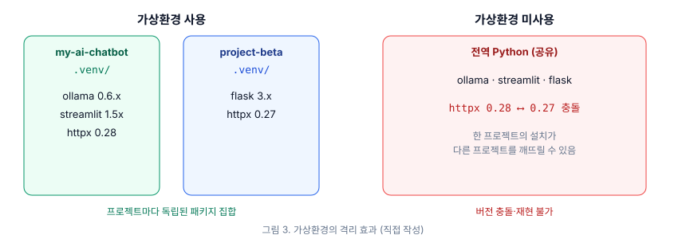
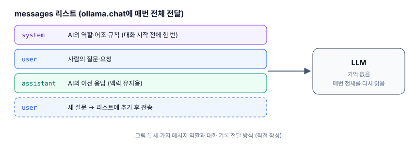
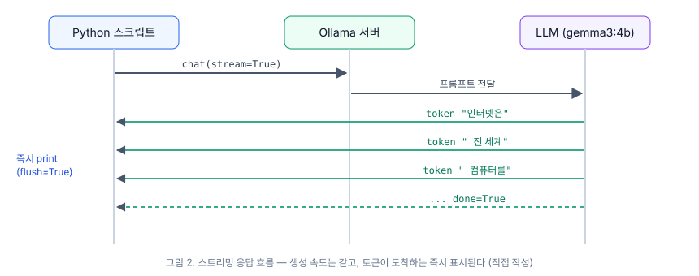

# [로컬 AI 스터디 2주차] 모델 다운로드부터 Ollama Python 챗봇까지

2주차에서는 교재 2부의 4~7장을 다룹니다. 1주차에 설치한 Ollama로 모델을 내려받아 대화하는 것부터 시작해, VS Code와 Python 개발 환경을 구성하고, 가상환경을 만든 뒤, Ollama Python 라이브러리로 멀티턴 챗봇을 작성하는 데까지가 범위입니다. 이 글에서는 각 장의 주요 내용을 정리하고, 1주차와 같은 맥북에서 진행한 실습 과정과 결과를 함께 기록합니다.

| 항목 | 내용 |
| --- | --- |
| 기기 | MacBook Pro, Apple M4 Pro (14코어), 24GB 통합 메모리 |
| OS | macOS 26.5 |
| Ollama | 0.40.11 (Homebrew) |
| Python | 3.13 (Homebrew `python@3.13`) |
| 사용 모델 | `gemma3:4b`, `qwen3.5:4b`, `phi3:mini` |

---

## 4장. LLM 다운로드 및 첫 번째 대화

### 모델 내려받기와 이름 형식

`brew install`이 소프트웨어를 설치하듯, `ollama pull`은 모델 가중치를 내려받습니다. 교재는 첫 모델로 Google DeepMind의 `gemma3:4b`(40억 파라미터, 약 3.3GB)를 사용합니다. 교재 집필 이후 Gemma 4가 출시되었지만, 다양한 사양의 Mac에서 결과를 일관되게 재현하기 위해 `gemma3:4b`를 기본 모델로 유지한다고 설명합니다.

모델 이름은 `모델명:태그` 형식입니다. `gemma3:4b`는 Gemma 3 계열의 4B 버전을 의미하며, 태그는 의류 사이즈처럼 같은 모델의 크기를 구분합니다. 한 번 내려받은 모델은 `ollama rm`으로 삭제하기 전까지 디스크에 남습니다.

### 대화형 채팅

`ollama run gemma3:4b`를 실행하면 프롬프트가 `>>>`로 바뀌며 대화형 모드에 들어갑니다. `/bye` 또는 `Ctrl-D`로 종료하며, `ollama run gemma3:4b "질문"`처럼 질문을 인자로 넘기면 한 번만 응답을 받고 바로 터미널로 돌아옵니다. 언어 모델은 비결정적이므로 같은 질문에도 매번 표현이 조금씩 다른 답이 나옵니다.

강의에서는 교재 부록의 대화형 모드 명령어(표 A.10)도 함께 소개했습니다.

| 동작 | 명령어 |
| --- | --- |
| 세션 종료 | `/bye` |
| 시스템 프롬프트 설정 | `/set system <메시지>` |
| 생성 파라미터 설정 | `/set parameter temperature 0.7` |
| 모델 정보 표시 | `/show info` |
| Modelfile 표시 | `/show modelfile` |
| 대화 컨텍스트 초기화 | `/clear` |
| 여러 줄 입력 | `"""` |

### 모델 크기, 메모리, 양자화

파라미터는 학습으로 조정된 신경망의 수치 값입니다. 파라미터가 많을수록 응답 품질은 좋아지지만, 메모리를 더 쓰고 속도는 느려집니다. 교재는 모델을 고를 때 다음 표를 첫 번째 기준으로 삼도록 권합니다.

| 모델 크기 | 대략적인 필요 RAM | 일반적인 용도 |
| --- | --- | --- |
| 1B~3B | 2~4GB | 간단한 Q&A, 텍스트 정리 |
| 7B~9B | 5~8GB | 일반 대화, 글쓰기, 코딩 보조 |
| 13B~14B | 10~16GB | 복잡한 분석, 상세한 글쓰기 |
| 27B~32B | 20~32GB | 고급 추론, 전문 업무 |
| 70B 이상 | 40GB 이상 | 연구, 최상위 품질 |

`q4_0`, `q8_0` 같은 태그는 양자화 수준을 나타냅니다. 양자화는 가중치의 정밀도를 낮춰 모델을 압축하는 기법이며, q4 모델은 q8 모델의 약 절반 메모리로 동작하면서 품질 저하가 크지 않습니다. 1주차에서 확인했듯 이 맥북은 GPU 가용 메모리가 약 17.8GiB이므로, 위 표 기준으로 14B 모델까지는 여유 있게 사용할 수 있습니다.

### 모델 계열 비교와 관리 명령어

| 모델 계열 | 개발사 | 주요 크기 | 강점 |
| --- | --- | --- | --- |
| Gemma 3 | Google DeepMind | 4B, 12B, 27B | 효율적, 추론 성능 |
| Llama 4 | Meta | Scout(109B), Maverick(400B) | 범용, 큰 커뮤니티 |
| Qwen 3.5 | Alibaba Cloud | 4B~72B | 다국어, 수학 |
| Mistral | Mistral AI | 7B, 8x7B | 빠른 추론 |
| Phi-3 | Microsoft | 3.8B, 14B | 경량 배포 |

모델 관리에는 `ollama list`(내려받은 모델), `ollama ps`(메모리에 로드된 모델), `ollama show`(상세 정보), `ollama rm`(삭제)을 사용합니다.

---

## 5장. VS Code와 Python 개발 환경

### VS Code와 Homebrew Cask

5장부터는 터미널 명령 대신 Python 코드를 작성합니다. 교재는 편집기로 VS Code를 사용하며, Homebrew의 `--cask` 옵션으로 설치합니다. Cask는 명령줄 도구와 구분되는 그래픽 데스크톱 애플리케이션용 패키지를 가리킵니다.

```bash
brew install --cask visual-studio-code
```

설치하면 `code` 명령이 함께 연결되어 `code ~/my-ai-chatbot`처럼 터미널에서 폴더를 바로 열 수 있습니다.

### Python 3.13과 Python 확장

교재는 `brew install python@3.13`으로 Python 3.13을 설치합니다. 컴파일이 필요한 일부 AI·오디오 패키지가 더 최신 버전을 안정적으로 지원하지 않을 수 있으므로, 시스템에 다른 버전이 있더라도 프로젝트에는 3.13을 사용하도록 권장합니다.

VS Code에는 Microsoft의 Python 확장(`ms-python.python`)을 설치합니다. 구문 강조, IntelliSense 자동 완성, 오류 밑줄, 디버거, 원클릭 실행 기능이 추가됩니다.

### 통합 터미널과 프로젝트 구조

VS Code의 통합 터미널(`Ctrl-``)은 macOS 터미널과 같은 zsh 셸이며, 편집기와 실행 결과를 한 창에서 볼 수 있습니다. 교재는 `~/my-ai-chatbot` 폴더를 만들어 다음 구조로 프로젝트를 확장해 나갑니다.

```text
my-ai-chatbot/
├── hello.py            # 테스트 파일
├── .venv/              # 가상환경 (6장)
├── requirements.txt    # 의존성 목록 (6장)
├── chat_basic.py       # CLI 챗봇 (7장)
├── chat_stream.py      # 스트리밍 챗봇 (7장)
└── app.py              # Streamlit 챗봇 (8~9장)
```

---

## 6장. Python 가상환경

### 가상환경이 필요한 이유

가상환경이 없으면 모든 프로젝트가 전역 Python의 패키지를 공유하게 됩니다. 이 경우 프로젝트마다 같은 패키지의 다른 버전이 필요할 때 충돌이 발생합니다. 교재는 가상환경의 이점으로 격리(isolation), 재현성(reproducibility), 청결함(cleanliness)을 듭니다.



### 생성, 활성화, 비활성화

```bash
python3.13 -m venv .venv      # 생성 (-m venv: 모듈 이름, .venv: 폴더 이름)
source .venv/bin/activate     # 활성화 → 프롬프트에 (.venv) 표시
deactivate                    # 비활성화
```

폴더 이름은 `.venv`를 사용합니다. 비밀 값을 담는 `.env` 파일과 혼동될 수 있어 `.env`라는 이름은 피하도록 안내합니다. 활성화하지 않은 상태에서 `pip install`을 실행하면 패키지가 전역 Python에 설치되므로, 설치 전에는 항상 `(.venv)` 표시를 확인해야 합니다.

### pip와 requirements.txt

```bash
pip install ollama streamlit          # 패키지 설치
pip freeze > requirements.txt         # 설치된 패키지와 정확한 버전 기록
pip install -r requirements.txt       # 다른 환경에서 복원
```

`.venv` 폴더는 용량이 크고 플랫폼에 종속되므로 공유하지 않습니다. 대신 `requirements.txt`를 공유하고, Git을 사용한다면 `.gitignore`에 `.venv/`를 추가합니다.

강의에서는 교재의 `venv` + `pip` 방식과 함께 **uv**도 소개했습니다. uv는 Rust로 작성된 Python 패키지·환경 관리 도구입니다. `uv venv --python 3.13 --seed`로 가상환경을 만들고, `uv pip install`처럼 pip와 거의 같은 인터페이스를 제공합니다. 교재도 uv를 유효한 대안으로 언급합니다. 이번 실습은 교재 흐름을 따라 `venv`로 진행하고, uv는 비교용으로 함께 확인했습니다.

---

## 7장. Ollama Python 라이브러리로 LLM 제어하기

### 첫 번째 스크립트

`ollama.chat()`은 로컬 Ollama 서버에 메시지를 보내고, 응답을 딕셔너리 형태로 돌려줍니다. 응답 본문은 `response["message"]["content"]`로 꺼냅니다. API 키나 클라우드 서비스 없이 코드 몇 줄로 로컬 모델을 호출할 수 있습니다.

### 메시지의 세 가지 역할



| 역할 | 의미 |
| --- | --- |
| `system` | AI의 성격, 어조, 규칙을 정하는 지시 (시스템 프롬프트) |
| `user` | 사람의 입력 |
| `assistant` | AI의 이전 응답. 포함하면 모델이 맥락을 유지 |

교재는 system 메시지를 AI의 동작을 제어하는 가장 강력한 수단으로 설명합니다. 다만 작은 모델일수록 system 지시를 덜 충실히 따르는 경향이 있습니다.

### 스트리밍 응답

`stream=True`를 지정하면 응답이 하나의 딕셔너리가 아니라 조각(chunk)이 차례로 도착하는 이터레이터로 바뀝니다. `print(..., end="", flush=True)`로 조각을 즉시 출력하면 ChatGPT처럼 글자가 흘러나오는 효과를 얻을 수 있습니다. 스트리밍은 생성 속도를 높이지 않으며, 전체 소요 시간은 같고 체감 반응성만 개선됩니다.



### 대화 기록 유지

LLM에는 기억이 없습니다. `ollama run`에서 모델이 이전 대화를 기억하는 것처럼 보인 이유는 Ollama가 매번 대화 기록 전체를 다시 보냈기 때문입니다. 직접 작성하는 스크립트에서는 `history` 리스트에 user와 assistant 메시지를 차례로 추가하고, 호출할 때마다 리스트 전체를 전달해야 합니다. 대화가 길어지면 컨텍스트 윈도우를 넘어 앞부분을 잊게 되며, 이 문제는 11장에서 다룹니다.

---

## 실습

1주차 환경에 이어서 진행했습니다. 출력의 사용자 홈 경로는 `/Users/<user>`로 표기했습니다.

### 1. 첫 모델 내려받기

첫 번째 터미널에서 `ollama serve`를 실행해 둔 상태에서, 두 번째 터미널에서 모델을 내려받았습니다.

```text
$ ollama pull gemma3:4b
pulling manifest
pulling aeda25e63ebd: 100% ▕██████████████████████████████▏ 3.3 GB
pulling e0a42594d802: 100% ▕██████████████████████████████▏  358 B
pulling dd084c7d92a3: 100% ▕██████████████████████████████▏ 8.4 KB
pulling 3116c5225075: 100% ▕██████████████████████████████▏   77 B
pulling b6ae5839783f: 100% ▕██████████████████████████████▏  489 B
verifying sha256 digest
writing manifest
success
```

### 2. 대화형 채팅과 표 A.10 명령어

```text
$ ollama run gemma3:4b
>>> 안녕하세요! 당신은 누구인가요?
안녕하세요! 저는 Google DeepMind에서 개발한 오픈 웨이트 대규모 언어 모델 Gemma입니다.
텍스트로 된 질문에 답하거나, 글을 쓰고, 번역하고, 요약하는 등 다양한 작업을 도와드릴 수
있습니다. 무엇을 도와드릴까요?

>>> 인공 신경망이 무엇인지 10살 어린이도 이해할 수 있게 쉽게 설명해 줘.
작은 도우미 친구들이 아주 많이 모여서 쪽지를 주고받는다고 생각해 보세요! 🐱
고양이 사진을 보여 주면, 첫 번째 친구들은 "털이 있나?", "귀가 뾰족한가?" 같은 간단한 것을
살펴보고 쪽지를 다음 친구들에게 넘겨요. 다음 친구들은 "수염이 있나?", "꼬리가 있나?"처럼
조금 더 큰 특징을 보고요. 마지막 친구들이 모든 쪽지를 모아서 "이건 고양이야!"라고 말해요.

인공 신경망은 이렇게 작은 부분들이 힘을 합쳐 조금씩 무언가를 알아내는 컴퓨터 프로그램이에요!
```

4B 모델이지만 한국어 질문에도 자연스럽게 답했습니다. 이어서 강의에서 소개한 대화형 명령어를 확인했습니다.

```text
>>> /show info
  Model
    architecture        gemma3
    parameters          4.3B
    context length      131072
    embedding length    2560
    quantization        Q4_K_M

  Capabilities
    completion
    vision

  Parameters
    stop           "<end_of_turn>"
    temperature    1
    top_k          64
    top_p          0.95

  License
    Gemma Terms of Use
    Last modified: February 21, 2024

>>> /set system 당신은 모든 답을 한 문장으로만 하는 간결한 비서입니다.
Set system message.
>>> 광합성이 뭐야?
광합성은 식물이 빛 에너지를 이용해 물과 이산화탄소로 포도당과 산소를 만드는 과정입니다.

>>> /clear
Cleared session context
>>> /bye
```

`/set system`을 적용하자 답변이 한 문장으로 짧아졌습니다. 7장에서 코드로 다룰 system 메시지를 대화형 모드에서 먼저 확인할 수 있었습니다. 대화형 모드에 들어가지 않는 원샷 질문도 실행해 보았습니다.

```text
$ ollama run gemma3:4b "로미오와 줄리엣의 줄거리를 세 문장으로 요약해 줘."
베로나의 원수 가문인 몬태규가의 로미오와 캐풀렛가의 줄리엣은 무도회에서 만나 첫눈에 사랑에
빠지고 비밀리에 결혼합니다. 그러나 싸움 끝에 로미오가 줄리엣의 사촌을 죽여 추방되고, 줄리엣은
원치 않는 결혼을 피하려고 죽은 것처럼 보이는 약을 먹습니다. 계획을 전달받지 못한 로미오가
줄리엣이 죽은 줄 알고 독약을 마시자, 깨어난 줄리엣도 뒤따라 목숨을 끊고 두 가문은 화해합니다.
$
```

### 3. 두 번째 모델과 비교

비교를 위해 `qwen3.5:4b`를 추가로 내려받고, 같은 질문을 `--verbose` 옵션과 함께 실행했습니다.

```text
$ ollama pull qwen3.5:4b
pulling manifest
pulling dde5aa3fc5ff: 100% ▕██████████████████████████████▏ 3.1 GB
...
verifying sha256 digest
writing manifest
success

$ ollama list
NAME          ID              SIZE      MODIFIED
qwen3.5:4b    7f3251fa6878    4.0 GB    12 seconds ago
gemma3:4b     a2af6cc3eb7f    3.3 GB    18 minutes ago
```

```text
$ ollama run gemma3:4b --verbose "삶의 의미는 무엇일까?"
삶의 의미는 철학자와 사상가들이 수천 년 동안 고민해 온 매우 개인적인 질문입니다. 하나의 정답은
없지만, 많은 관점에서 삶의 의미는 목적을 찾고, 의미 있는 관계를 맺고, 주변 세상에 긍정적으로
기여하는 데 있다고 봅니다.

total duration:       2.104837291s
load duration:        1.162447667s
prompt eval count:    18 token(s)
prompt eval rate:     246.37 tokens/s
eval count:           71 token(s)
eval duration:        894.216ms
eval rate:            79.40 tokens/s
```

```text
$ ollama run qwen3.5:4b --verbose "삶의 의미는 무엇일까?"
정말 심오한 질문이네요! 삶의 의미는 인류가 가장 오래 고민해 온 철학적 질문 중 하나입니다.
보편적인 정답은 없지만, 대표적인 관점은 다음과 같습니다.

1. 실존주의적 관점: 삶에는 정해진 의미가 없으며, 우리가 선택과 행동으로 스스로 의미를 만듭니다.
2. 종교적 관점: 많은 신앙은 더 높은 존재를 섬기고 그 뜻을 따르는 것을 삶의 목적으로 봅니다.
3. 인본주의적 관점: 행복을 추구하고 고통을 줄이며 인간의 번영에 기여하는 것이 삶의 의미입니다.

결국 삶의 의미는 당신이 무엇이라고 정하느냐에 달려 있을지도 모릅니다.

total duration:       3.287512958s
load duration:        1.305881125s
prompt eval count:    21 token(s)
prompt eval rate:     231.72 tokens/s
eval count:           143 token(s)
eval duration:        1.958407s
eval rate:            73.02 tokens/s
```

교재에서 설명한 대로 Gemma는 간결하게, Qwen은 번호를 매긴 구조로 답했습니다. 같은 4B급 모델이지만 응답 스타일, 즉 모델의 "성격"이 뚜렷하게 다릅니다. 생성 속도는 두 모델 모두 초당 70~80토큰 수준이었습니다.

### 4. 모델 관리 명령어와 메모리 확인

두 모델을 연달아 실행한 직후 `ollama ps`를 확인했습니다.

```text
$ ollama ps
NAME          ID              SIZE      PROCESSOR    CONTEXT    UNTIL
qwen3.5:4b    7f3251fa6878    4.6 GB    100% GPU     4096       4 minutes from now
gemma3:4b     a2af6cc3eb7f    4.3 GB    100% GPU     4096       3 minutes from now
```

두 모델이 동시에 메모리에 올라가 있었고, 합계 약 8.9GB로 GPU 가용 메모리(17.8GiB) 안에 여유 있게 들어갔습니다. 교재 예시에서는 한 번에 하나의 모델만 표시되지만, 메모리가 충분하면 Ollama는 여러 모델을 동시에 유지합니다. 활성 상태 보기의 메모리 압력도 초록색을 유지했습니다.

```text
$ ollama show gemma3:4b | grep -i context
    context length      131072

$ ollama pull phi3:mini
...
success

$ ollama rm phi3:mini
deleted 'phi3:mini'
```

`context length`는 131072(128K)로 표시되지만, `ollama ps`의 `CONTEXT`는 4096입니다. 모델이 지원하는 최대 길이와, Ollama가 메모리 상황에 맞춰 실제로 할당한 길이는 다릅니다. 이 차이는 7장의 대화 기록 실습과 이어지는 부분이라 기록해 둡니다. `phi3:mini`는 4장 연습문제 4번(집 정리하기)에 따라 내려받고 삭제했다가, 7장 토론 실습을 위해 다시 내려받았습니다.

### 5. VS Code와 Python 3.13 확인

이 맥북에는 VS Code가 이미 설치되어 있어 버전과 `code` 명령만 확인했습니다.

```text
$ code --version
1.105.1
7d842fb85a0275a4a8e4d7e040d2625abbf7f084
arm64

$ brew install python@3.13
==> Fetching downloads for: python@3.13
✔︎ Bottle python@3.13 (3.13.9)
==> Pouring python@3.13--3.13.9.arm64_tahoe.bottle.tar.gz
==> /opt/homebrew/Cellar/python@3.13/3.13.9/bin/python3.13 -Im ensurepip
==> /opt/homebrew/Cellar/python@3.13/3.13.9/bin/python3.13 -Im pip install -v --no-index --upgrade ...
🍺  /opt/homebrew/Cellar/python@3.13/3.13.9: 3,621 files, 66.3MB

$ python3.13 --version
Python 3.13.9
```

`arm64`가 표시되므로 VS Code가 Apple Silicon에서 네이티브로 실행되고 있습니다. 통합 터미널에서 세 도구에 모두 접근할 수 있는지 확인한 뒤, 프로젝트 폴더와 첫 Python 파일을 만들었습니다.

```text
$ brew --version && ollama --version && python3.13 --version
Homebrew 6.0.5
ollama version is 0.40.11
Python 3.13.9

$ mkdir ~/my-ai-chatbot && code ~/my-ai-chatbot
$ python3.13 hello.py
Hello, World!
My AI chatbot project starts here!
```

### 6. 가상환경 생성과 패키지 설치

```text
$ cd ~/my-ai-chatbot
$ python3.13 -m venv .venv
$ ls -a
.  ..  .venv  hello.py
$ ls .venv
bin  include  lib  pyvenv.cfg

$ source .venv/bin/activate
(.venv) $ which python3
/Users/<user>/my-ai-chatbot/.venv/bin/python3
```

활성화 전에는 `/opt/homebrew/bin/python3`를 가리키던 경로가 프로젝트의 `.venv` 안으로 바뀌었습니다. 이어서 챗봇에 필요한 두 패키지를 설치했습니다.

```text
(.venv) $ pip install ollama streamlit
Collecting ollama
  Downloading ollama-0.6.1-py3-none-any.whl.metadata (4.3 kB)
Collecting streamlit
  Downloading streamlit-1.51.0-py3-none-any.whl.metadata (9.5 kB)
Collecting httpx>=0.27 (from ollama)
  Downloading httpx-0.28.1-py3-none-any.whl.metadata (7.1 kB)
Collecting pydantic>=2.9 (from ollama)
...
Successfully installed altair-5.5.0 attrs-25.4.0 blinker-1.9.0 cachetools-6.2.1 certifi-2025.10.5
... httpx-0.28.1 ... ollama-0.6.1 ... pandas-2.3.3 ... streamlit-1.51.0 ...

(.venv) $ pip list | wc -l
      44
(.venv) $ pip freeze > requirements.txt
(.venv) $ grep -E '^(ollama|streamlit|httpx)==' requirements.txt
httpx==0.28.1
ollama==0.6.1
streamlit==1.51.0
```

직접 설치한 패키지는 두 개지만, 의존성을 포함해 40개가 넘는 패키지가 설치되었습니다. 6장 연습문제 5번(의존성 이해하기)을 통해 의존성이 어떻게 연결되는지도 확인했습니다.

```text
(.venv) $ pip show streamlit | grep Requires
Requires: altair, blinker, cachetools, click, gitpython, numpy, packaging, pandas, pillow,
protobuf, pyarrow, pydeck, requests, tenacity, toml, tornado, typing-extensions
```

비교를 위해 강의에서 소개한 uv로도 같은 환경을 만들어 보았습니다.

```text
$ mkdir ~/uv-test && cd ~/uv-test
$ uv venv --python 3.13 --seed
Using CPython 3.13.9 interpreter at: /opt/homebrew/opt/python@3.13/bin/python3.13
Creating virtual environment with seed packages at: .venv
 + pip==25.2
Activate with: source .venv/bin/activate
$ source .venv/bin/activate
(uv-test) $ uv pip install ollama streamlit
Resolved 43 packages in 412ms
Prepared 43 packages in 2.08s
Installed 43 packages in 96ms
 + ollama==0.6.1
 + streamlit==1.51.0
 ...
```

pip로는 설치에 30초가량 걸렸지만, uv는 패키지 해석부터 설치까지 3초 안에 끝났습니다. 명령 체계가 pip와 거의 같아 교재 흐름을 따르면서 uv로 바꿔 쓰기에도 무리가 없어 보입니다.

### 7. 첫 Ollama Python 스크립트

강의 자료의 권장에 따라 질문을 한국어로 바꾸어 `chat_basic.py`를 작성했습니다.

```python
import ollama

response = ollama.chat(
    model="gemma3:4b",
    messages=[
        {"role": "user", "content": "프랑스의 수도는 어디인가요?"}
    ],
)

print(response["message"]["content"])
```

```text
(.venv) $ python chat_basic.py
프랑스의 수도는 파리입니다. 파리는 프랑스 중북부 센강 유역에 위치하며, 에펠탑, 루브르 박물관,
노트르담 대성당 같은 랜드마크로 유명합니다.
```

### 8. system 메시지 실험

`chat_system.py`에서 system 메시지만 바꾸어 같은 질문("중력은 어떻게 작용하나요?")을 실행했습니다.

```python
import ollama

response = ollama.chat(
    model="gemma3:4b",
    messages=[
        {
            "role": "system",
            "content": "당신은 재미있는 비유로 개념을 설명하는 친절한 과학 선생님입니다. "
                       "답변은 100단어 이내로 하세요."
        },
        {"role": "user", "content": "중력은 어떻게 작용하나요?"},
    ],
)

print(response["message"]["content"])
```

```text
(.venv) $ python chat_system.py
커다란 트램펄린을 떠올려 보세요! 가운데에 볼링공을 올려놓으면 천이 움푹 꺼지죠? 지구 같은 무거운
물체도 우주라는 천을 그렇게 움푹하게 만듭니다. 그러면 근처의 작은 물체들은 그 움푹한 곳을 향해
굴러가게 되는데, 이것이 바로 중력이에요. 물체가 무거울수록 더 깊이 꺼지고, 더 세게 끌어당깁니다.
태양이 만든 깊은 웅덩이 덕분에 행성들이 그 주위를 빙글빙글 도는 거랍니다! 😊
```

7장 연습문제 1번(성격 바꾸기)에 따라 system 메시지를 세 가지로 바꾸고, 같은 질문("광합성이 무엇인가요?")을 실행해 결과를 비교했습니다.

| system 메시지 | 응답 특징 |
| --- | --- |
| 정밀함을 요구하는 엄격한 수학 교수 | 화학 반응식(6CO₂ + 6H₂O → C₆H₁₂O₆ + 6O₂)을 먼저 제시하고 용어를 엄밀하게 정의 |
| 쉬운 단어와 격려를 쓰는 유치원 선생님 | "식물이 햇빛으로 밥을 만드는 거예요!"처럼 짧은 문장과 감탄사 위주 |
| 퉁명스럽지만 박식한 사서 | 핵심만 짧게 설명한 뒤 마지막에 관련 도서를 추천 |

같은 모델과 같은 질문인데도 system 메시지만으로 어조, 구조, 정보 밀도가 크게 달라졌습니다.

### 9. 스트리밍과 응답 시간 측정

`chat_stream.py`에 연습문제 4번의 시간 측정 코드를 추가했습니다.

```python
import time
import ollama

start = time.time()
first_token = None

stream = ollama.chat(
    model="gemma3:4b",
    messages=[
        {"role": "system", "content": "당신은 친절한 비서입니다. 자세하고 사려 깊게 답하세요."},
        {"role": "user", "content": "인터넷이 어떻게 작동하는지 쉽게 설명해 주세요."},
    ],
    stream=True,
)

for chunk in stream:
    if first_token is None:
        first_token = time.time()
    print(chunk["message"]["content"], end="", flush=True)

end = time.time()
print(f"\n\nFirst token: {first_token - start:.2f} seconds")
print(f"Response time: {end - start:.2f} seconds")
```

```text
(.venv) $ python chat_stream.py
인터넷은 전 세계의 컴퓨터를 서로 연결한 거대한 도로망이라고 생각하면 쉽습니다.
...
(중략)
...
이렇게 작은 조각으로 나뉜 데이터가 여러 경로를 거쳐 목적지에서 다시 합쳐지는 것이 인터넷의
기본 원리입니다.

First token: 0.31 seconds
Response time: 7.84 seconds
```

같은 질문을 `phi3:mini`로도 실행해 비교했습니다.

| 모델 | 첫 토큰 | 전체 응답 시간 | 관찰 |
| --- | --- | --- | --- |
| gemma3:4b | 0.31초 | 7.84초 | 한국어가 자연스럽고 구조가 명확 |
| phi3:mini | 0.24초 | 5.12초 | 더 빠르지만 한국어 표현이 어색하고 일부 영어가 섞임 |

두 모델 모두 첫 토큰이 0.3초 안팎에 표시되어, 전체 응답에 5~8초가 걸리는데도 기다린다는 느낌이 거의 없었습니다. 스트리밍이 생성 속도가 아니라 체감 반응성을 개선한다는 교재의 설명을 확인할 수 있었습니다. 또한 속도와 품질이 반드시 비례하지는 않았습니다. `phi3:mini`는 더 빨랐지만, 한국어 응답 품질은 `gemma3:4b`가 더 좋았습니다.

### 10. 대화 기록 유지와 저장

강의 자료의 샘플을 참고해, 대화를 종료하면 기록을 파일로 저장하는 `chat_history.py`를 작성했습니다(연습문제 5번). 교재 코드와 다른 점은 한국어 저장을 위해 `encoding="utf-8"`을 지정한 것과, `Ctrl-C`로 종료할 때도 저장되도록 루프를 `try/finally`로 감싼 것입니다.

```python
import ollama

history = [
    {"role": "system", "content": "당신은 친절하고 도움이 되는 비서입니다. 답변은 간결하면서도 충실하게 하세요."}
]

print("Chat with AI! (type 'quit', 'exit', or 'bye' to exit)")
print("-" * 40)

try:
    while True:
        user_input = input("\nYou: ")
        if user_input.lower() in ("quit", "exit", "bye"):
            print("\nGoodbye!")
            break

        history.append({"role": "user", "content": user_input})

        stream = ollama.chat(model="gemma3:4b", messages=history, stream=True)

        print("\nAI: ", end="")
        response_text = ""
        for chunk in stream:
            piece = chunk["message"]["content"]
            print(piece, end="", flush=True)
            response_text += piece
        print()

        history.append({"role": "assistant", "content": response_text})
finally:
    with open("chat_log.txt", "w", encoding="utf-8") as f:
        for msg in history:
            f.write(f"[{msg['role'].upper()}]\n{msg['content']}\n\n")
    print("Conversation saved to chat_log.txt")
```

```text
(.venv) $ python chat_history.py
Chat with AI! (type 'quit', 'exit', or 'bye' to exit)
----------------------------------------

You: 안녕하세요! 제 이름은 민준입니다.

AI: 안녕하세요, 민준 님! 만나서 반갑습니다. 오늘 무엇을 도와드릴까요?

You: 제 이름이 뭐라고 했죠?

AI: 민준 님이라고 하셨어요! 😊

You: 프로그래밍 입문자에게 좋은 책을 추천해 주세요.

AI: 민준 님께는 Al Sweigart의 『Automate the Boring Stuff with Python』을 추천드려요. 파일 이름
바꾸기, 웹 스크래핑, 엑셀 자동화 같은 실용적인 예제로 Python을 배울 수 있고, 온라인에서 무료로
읽을 수도 있습니다.

You: bye

Goodbye!
Conversation saved to chat_log.txt

(.venv) $ head -8 chat_log.txt
[SYSTEM]
당신은 친절하고 도움이 되는 비서입니다. 답변은 간결하면서도 충실하게 하세요.

[USER]
안녕하세요! 제 이름은 민준입니다.

[ASSISTANT]
안녕하세요, 민준 님! 만나서 반갑습니다. 오늘 무엇을 도와드릴까요?
```

모델이 세 번째 질문에서도 이름을 불렀는데, 이는 스크립트가 매번 `history` 전체를 전송했기 때문입니다. 비교를 위해 `history`에 새 user 메시지만 담아 보내도록 바꾸자, 두 번째 질문에 "죄송하지만 저는 이름을 알 수 없습니다"라고 답했습니다. LLM 자체에는 기억이 없다는 점을 직접 확인할 수 있었습니다.

### 11. 두 모델의 토론 (도전 과제)

7장 연습문제 6번으로, `gemma3:4b`(고양이 편)와 `phi3:mini`(강아지 편)가 토론하는 `debate.py`를 실행했습니다. 핵심은 모델마다 별도의 history를 두고, 상대의 발언은 `user`로, 자신의 발언은 `assistant`로 넣는 것입니다.

```text
(.venv) $ python debate.py
Debate: cats vs dogs
----------------------------------------

[Opening question]
Why are cats the best pets?

=============== Round 1 ===============

[A (cats) / gemma3:4b]
Cats are the ultimate companions for modern life. They're independent, so they don't
need constant attention or walks in the rain, and they keep themselves impeccably clean.
...

[B (dogs) / phi3:mini]
While cats certainly have their charms, dogs offer something truly unmatched: unconditional
loyalty. A dog greets you at the door every single day, ...

=============== Round 2 ===============
...
=============== Round 3 ===============

[A (cats) / gemma3:4b]
... In the end, perhaps the best pet is the one that fits your lifestyle.

[B (dogs) / phi3:mini]
I agree — both cats and dogs bring joy in their own ways. It's been a pleasant debate!

Debate finished.

real    1m48.27s
```

3라운드에 약 1분 48초가 걸렸습니다. 강의 자료에 기록된 M1 Pro 16GB의 약 2분 30초보다 빨랐습니다. 두 모델이 동시에 메모리에 올라가 있어 라운드마다 모델을 다시 로드하지 않은 점도 영향을 준 것으로 보입니다. 관찰한 내용은 강의 자료의 결과와 대체로 일치했습니다.

- 3라운드에 이르자 두 모델이 "결국 취향 차이"라며 합의해 버렸습니다. LLM은 기본적으로 협조적이어서, 반박을 명시적으로 지시하지 않으면 의견이 수렴합니다.
- `phi3:mini`는 응답이 길고, 한 응답 안에서 상대 역할까지 이어서 쓰는 경우가 있었습니다.

강의 자료의 제안대로 system 메시지에 "Never change sides. Directly rebut the opponent's last point. Reply in under 80 words."를 추가하자, 3라운드까지 각자의 입장을 유지하며 짧게 반박을 주고받았습니다.

---

## 교재·강의 자료와 실습 환경의 차이

| 항목 | 교재 / 강의 자료 | 실습 환경 |
| --- | --- | --- |
| `ollama show` 출력 | `parameters 3.9B`, `quantization Q4_0` | `parameters 4.3B`, `quantization Q4_K_M`, Capabilities 항목 추가 |
| 동시 로드 모델 | `ollama ps`에 1개 표시 | 메모리가 충분해 2개 동시 유지 |
| 컨텍스트 | `context length 128000` | 모델 최대 131072, 실제 할당 4096 |
| ollama Python 패키지 | 0.4.7 | 0.6.1 |
| Streamlit | 1.41.1 | 1.51.0 |
| Python | 3.13.1 | 3.13.9 |
| 가상환경 도구 | 교재: `venv` + `pip` / 강의: uv 병행 | 두 방식 모두 확인 |
| debate.py 3라운드 | 약 2분 30초 (M1 Pro 16GB) | 약 1분 48초 (M4 Pro 24GB) |

---

## 정리

2주차를 마치며 정리한 내용은 다음과 같습니다.

- `ollama pull`·`run`·`list`·`ps`·`show`·`rm`으로 모델을 내려받고 관리할 수 있습니다. 모델은 크기와 메모리, 용도를 기준으로 고릅니다.
- 24GB 맥북에서는 4B급 모델 두 개를 동시에 올려도 여유가 있었고, 생성 속도는 초당 70~80토큰 수준이었습니다.
- Python 프로젝트는 반드시 가상환경 안에서 진행하고, `requirements.txt`로 환경을 공유합니다.
- 챗봇의 기본 구조는 "입력 받기 → history에 추가 → 전체 전송 → 스트리밍 표시 → 응답 저장"의 반복입니다. ChatGPT 같은 서비스도 같은 원리로 동작합니다.